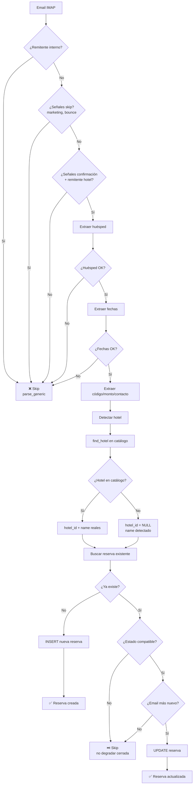

# Ingesta Genérica de Reservas - Cualquier Hotel del Catálogo

## Objetivo

Procesar automáticamente confirmaciones, modificaciones y anulaciones de **CUALQUIER hotel del catálogo Supabase**, no solo los que tienen parsers específicos (Huilo, Corralco, Puyehue, Aguas Calientes, RateHawk).

## Arquitectura

### Flujo de Procesamiento

```
Email IMAP
    ↓
parse_lifecycle (modificaciones/anulaciones) → ¿Match?
    ↓ NO
Parsers específicos (Huilo, RateHawk, etc) → ¿Match?
    ↓ NO
Parser genérico (parse_generic.py) → ¿Match?
    ↓ SÍ
Resolver hotel en catálogo Supabase
    ↓
Upsert con protecciones (no duplicar, estados)
```

### Estados de Reserva

1. **En gestión**: Pedido interno de ventas (desde `ventas@checkin24hs.com` u otro interno)
2. **Confirmada**: Confirmación del hotel (desde `info@termashuife.cl`, `reservas@hotel.cl`, etc)

### Protecciones Anti-Duplicación

El sistema NO duplica reservas cuando:
1. Existe reserva con el mismo código de confirmación
2. Existe reserva con el mismo hotel + huésped + fecha de check-in (clave natural)

Al llegar la confirmación del hotel sobre un pedido interno existente:
- Actualiza de "En gestión" → "Confirmada"
- Actualiza el código si cambió
- Respeta timestamps: solo actualiza si el email es más nuevo que `updated_at`

## Formatos Soportados

### Confirmaciones de Hotel

El parser genérico detecta confirmaciones cuando:
- ✅ El remitente es externo (no `@checkin24hs.com`)
- ✅ El asunto/cuerpo contiene señales de confirmación: "confirmamos", "nueva reserva", "reserva confirmada", "booking confirmed"
- ✅ El email contiene **huésped + fechas + hotel**
- ❌ NO es marketing/newsletter/bounce

### Formatos de Fechas

Soporta múltiples formatos de fechas en español e inglés:

1. **Formato compacto**: `In 26/11/2026 Out 28/11/2026`
2. **Rango con "por"**: `5/11 por 2 noches`
3. **Rango con "del/al"**: `del 10/12/2026 al 13/12/2026`
4. **Etiquetas separadas**:
   - `Check-in: 05/11/2026`
   - `Check-out: 07/11/2026`
5. **Formatos mixtos**: `15/12`, `15/12/2026`, `15 diciembre 2026`

### Extracción de Datos

#### Huésped
- Campos: `Nombre:`, `Guest:`, `Huésped:`, `Cliente:`
- Saludos: `Estimada María González,`, `Dear John Smith`

#### Hotel
- Desde asunto: `Nueva Reserva Termas de Huife - Checkin24hs`
- Desde remitente: `info@termashuife.cl` → "Termas Huife"
- Si no se detecta: `Hotel (revisar)` + `hotel_id = NULL`

#### Código de Reserva
- Patrones: `Código: PAT-2611-001`, `Reserva #12345678`
- Formato con guiones: `CI-261103-021`, `TPH-2026-123`
- Si no hay: genera temporal `GUEST-YYMMDD` (ej: `DIAN-261105`)

#### Monto
- Prioriza total/precio final (no seña ni subtotal)
- Formatos: `USD 494`, `$350.000 CLP`, `US$ 1,250.50`

#### Contacto
- Email del huésped (no del remitente)
- Teléfono: extrae de campo `Teléfono:` / `Phone:`

## Ejemplos Reales

### Caso 1: Termas de Huife - Nueva Reserva

**Email de ventas (NO procesado por parser genérico)**:
```
From: ventas@checkin24hs.com
Subject: Nueva Reserva Termas de Huife - Checkin24hs

Nueva Reserva
Nombre: Diana Panasiuk
Suite canelo
Fecha: 5/11 por 2 noches
2 adultos
Precio: 494 usd
Seña 20%: 98,8
Mail: diana.panasiuk@example.com
```

❌ **No procesado**: `is_internal_sender` → True

---

**Confirmación del hotel**:
```
From: info@termashuife.cl
Subject: Re: Nueva Reserva Termas de Huife - Checkin24hs

Junto con saludar, confirmamos la reserva para el huésped Diana Panasiuk.

Detalles de la reserva:
Nombre: Diana Panasiuk
Habitación: Suite Canelo
Check-in: 05/11/2026
Check-out: 07/11/2026
Noches: 2
Pasajeros: 2 adultos
Precio total: USD 494

https://termashuife.hotelero.pro/vikbooking?view=booking&sid=...
```

✅ **Procesado**:
- `hotel_key`: `termas_de_huife`
- `hotel_name`: "Termas de Huife"
- `client_name`: "Diana Panasiuk"
- `check_in`: `2026-11-05`
- `check_out`: `2026-11-07`
- `total_amount`: 494.0
- `currency`: "USD"
- `status`: "Confirmada"
- `agent_name`: "Email Termas de Huife"

### Caso 2: Modificación de Fechas

```
From: administracion@termashuife.cl
Subject: Modificación fechas pax David Glass

Modificación fechas pax David Glass.
Código de reserva: GLASS-123
In 26/11/2026
Out 28/11/2026
```

✅ **Procesado por `parse_lifecycle`** (no por genérico):
- Detecta código + hotel del catálogo
- Actualiza fechas en Supabase
- Estado: "Modificada"

### Caso 3: Hotel Nuevo (no en catálogo hardcodeado)

```
From: reservas@cabanaspatagonia.cl
Subject: Reserva Confirmada - Cabañas Patagonia

Estimada María González,

Su reserva ha sido confirmada:
Código: PAT-2611-001
Del 10/12/2026 al 13/12/2026
Precio total: $350.000 CLP
```

✅ **Procesado**:
- `hotel_key`: `cabanas_patagonia` (slugified)
- Busca en catálogo Supabase con `find_hotel("cabanas_patagonia")`
- Si encuentra: usa `hotel_id` real
- Si NO encuentra: `hotel_id = NULL`, `hotel_name = "Cabañas Patagonia"` (detectado)

## Límites y Exclusiones

### NO Procesa

❌ **Pedidos internos** (remitente `@checkin24hs.com`)
- Estos deben gestionarse manualmente o con otro flujo

❌ **Marketing / Newsletters**
- "oferta especial", "descuento", "promoción", "boletín"

❌ **Bounces / Errores**
- "undeliverable", "delivery status"

❌ **Emails sin datos completos**
- Sin huésped + sin fechas
- Sin señales de confirmación real

### Parsers Específicos (Prioridad Mayor)

Los parsers específicos **siempre tienen prioridad** sobre el genérico:
1. ✅ `parse_lifecycle` (modificaciones/anulaciones de cualquier hotel)
2. ✅ `parse_ratehawk` (códigos RateHawk específicos)
3. ✅ `parse_puyehue` (códigos VHQ6GU, agente/agencia)
4. ✅ `parse_huilo` (códigos CI-XXXXXX-XXX, tabla HTML)
5. ✅ `parse_corralco` (códigos Corralco específicos)
6. 🆕 `parse_generic` (fallback para cualquier otro hotel)

## Tests

### Ejecutar Tests

```bash
# Tests del parser genérico
python3 test_parse_generic.py -v

# Tests de integración (flujo completo)
python3 test_integration_generic.py -v

# Todos los tests
for test in test_*.py; do python3 $test -v; done
```

### Cobertura de Tests

- ✅ Confirmación de hotel genérico (Termas Huife, Cabañas Patagonia, etc)
- ✅ Múltiples formatos de fechas (compacto, rango, por noches)
- ✅ Extracción de huésped desde saludos (`Estimada María`, `Dear John`)
- ✅ Extracción de hotel desde remitente y asunto
- ✅ Códigos con múltiples formatos (`PAT-2611-001`, `CI-261103-021`, `12345678`)
- ✅ Exclusión de marketing, bounces, emails sin datos
- ✅ NO procesar pedidos internos

## Mantenimiento

### Agregar Hotel al Catálogo Supabase

Si un hotel NO está en el catálogo, el sistema crea la reserva con:
- `hotel_id = NULL`
- `hotel_name = "Hotel detectado"` o `"Hotel (revisar)"`

**Acción manual**: Agregar el hotel a la tabla `hotels` en Supabase con:
- `name`: Nombre completo oficial
- `id`: UUID generado automáticamente

El próximo sync detectará el hotel correctamente usando `find_hotel()`.

### Agregar Parser Específico

Si un hotel envía emails con formato MUY específico (tabla HTML, códigos únicos), crear:

1. `parse_hotelX.py` con funciones:
   - `looks_hotelX(from_addr, subject, text) -> bool`
   - `parse_hotelX_confirmations(mail) -> list[dict]`

2. Agregar en `sync.py` antes del `parse_generic`:
   ```python
   if looks_hotelX(from_addr, subject, f"{text}\n{html}"):
       rows = parse_hotelX_confirmations(mail)
       return "hotelX", rows
   ```

3. Tests en `test_parse_hotelX.py`

### Mejorar Detección

Si el parser genérico tiene falsos positivos/negativos:

1. **Falsos positivos** (detecta algo que no es reserva):
   - Agregar patrones a `_SKIP_SIGNALS` en `parse_generic.py`

2. **Falsos negativos** (no detecta una reserva real):
   - Agregar patrones a `_CONFIRMATION_SIGNALS`
   - Agregar formatos de fecha a `_DATE_IN_PATTERNS`, `_DATE_OUT_PATTERNS`
   - Agregar patrones de huésped a `_GUEST_PATTERNS`

## Diagrama de Flujo Detallado



## Próximos Pasos

1. ✅ Parser genérico implementado y testeado
2. ✅ Integración en `sync.py` con prioridades
3. ✅ Tests con ejemplos reales (Termas Huife, etc)
4. 🔜 Monitorear logs en producción
5. 🔜 Ajustar patrones según nuevos formatos encontrados
6. 🔜 Agregar hoteles faltantes al catálogo Supabase

## Autor y Fecha

- **Autor**: Cloud Agent (Cursor)
- **Fecha**: Noviembre 2026
- **Issue**: Ingesta genérica para cualquier hotel del catálogo
- **Contexto**: Termas de Huife era descartado; ahora cualquier hotel del catálogo es procesado
